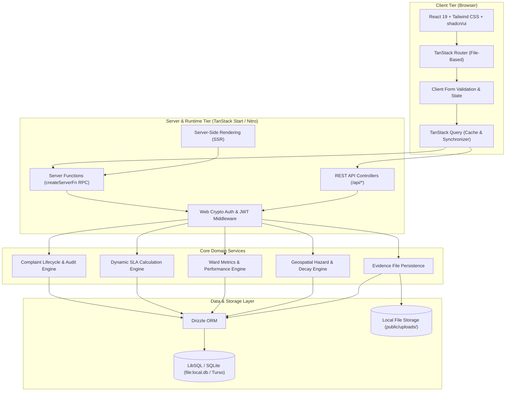
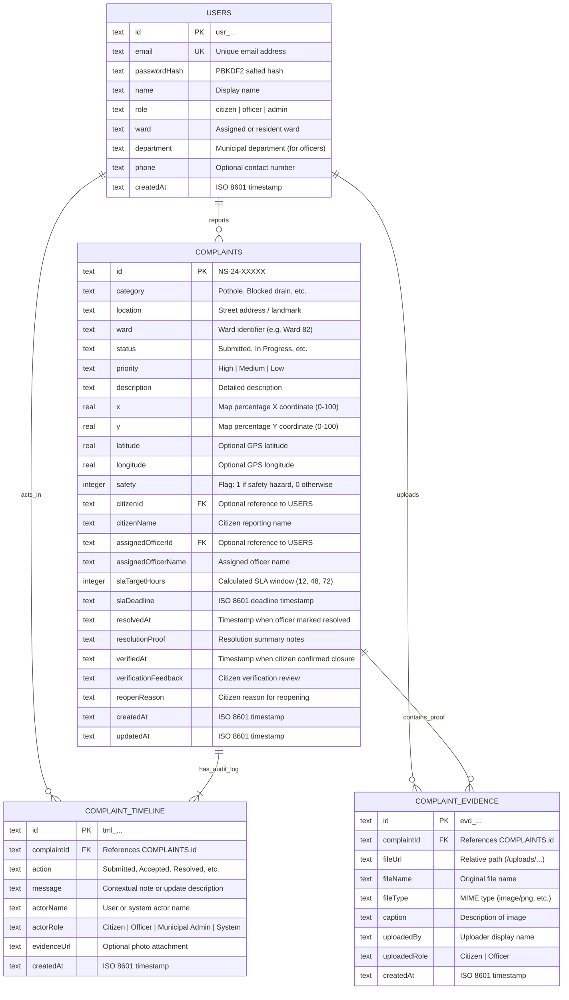
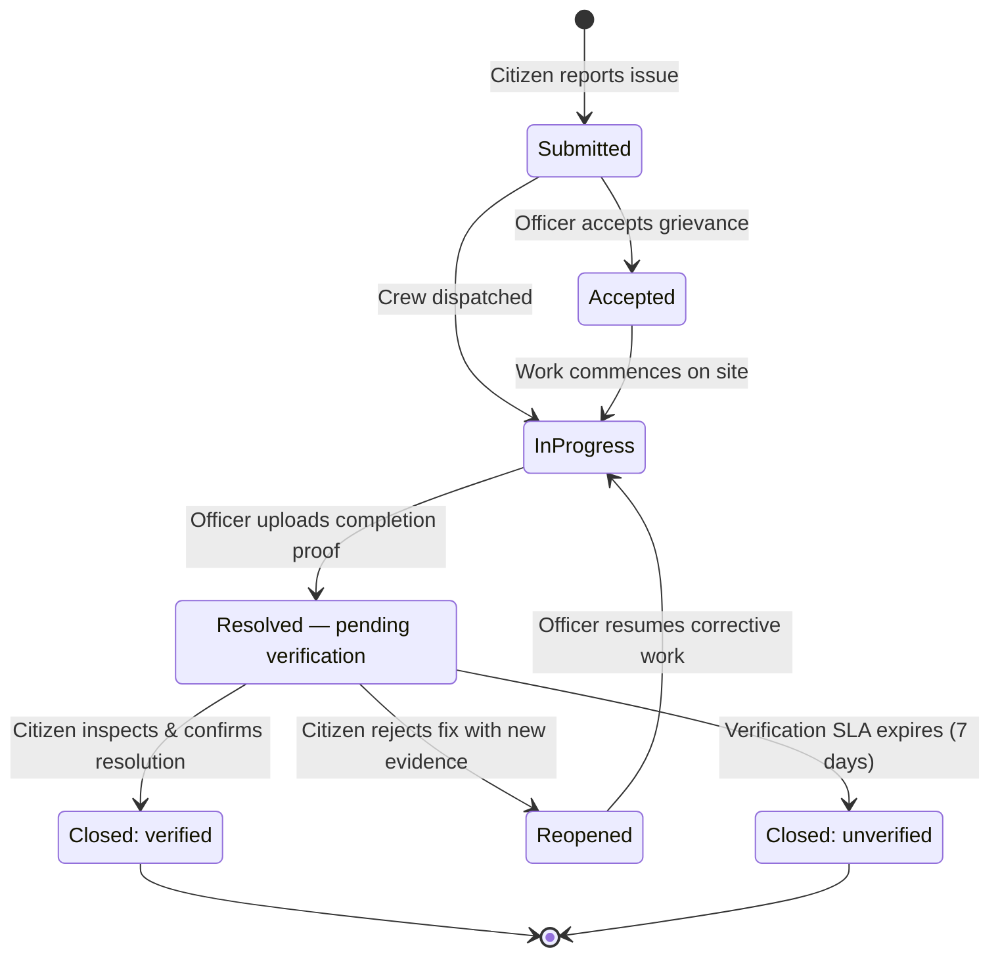
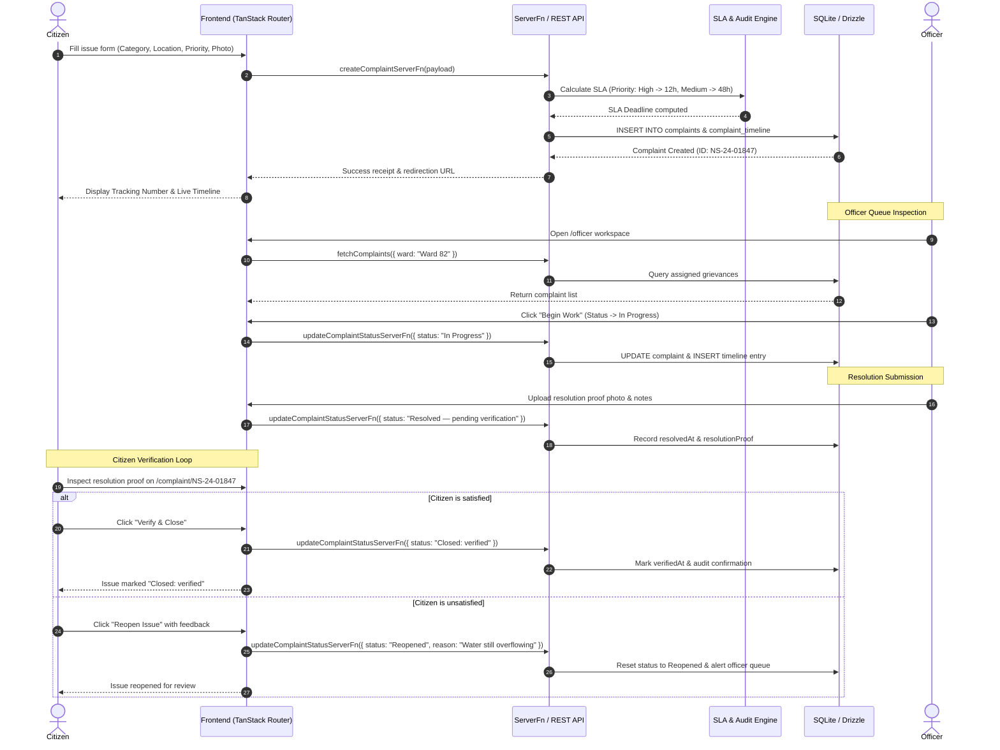
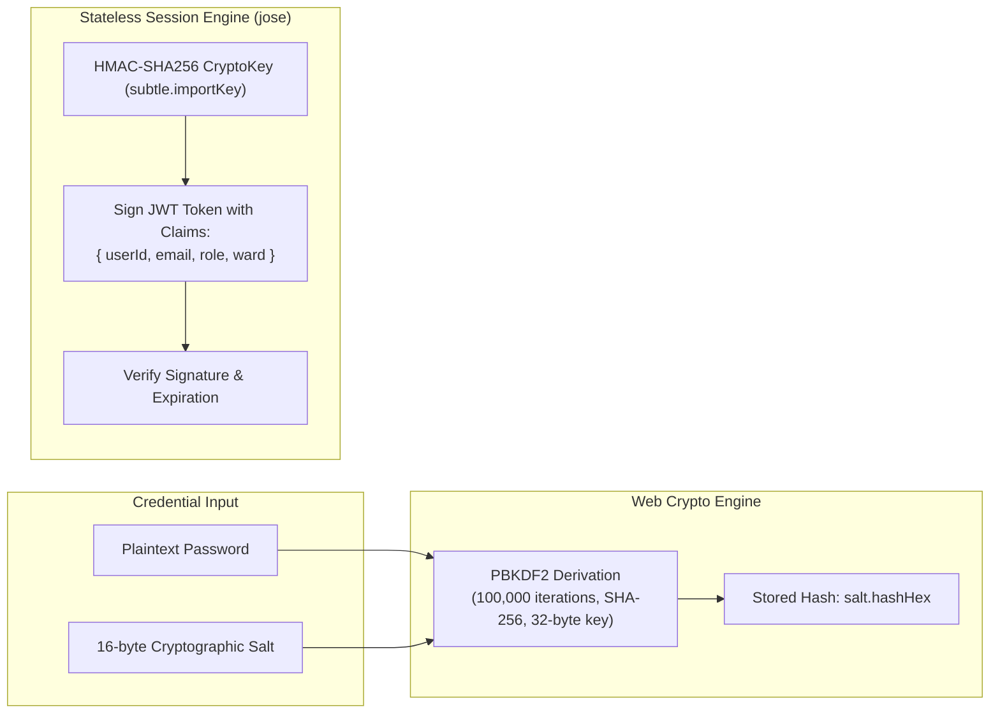

# NagarSeva — Technical Design Document

This document provides a comprehensive technical overview of the **NagarSeva** municipal grievance tracking and civic engagement platform, detailing its architecture, data models, state machines, sequence flows, security mechanisms, and algorithmic engines.

---

## 1. Executive Summary & Core Objectives

NagarSeva is designed to bridge the trust deficit between municipal administrations and citizens by enforcing accountability and transparency across the grievance resolution lifecycle. 

Key architectural goals include:
1. **End-to-End Visibility**: Every complaint is publicly traceable with an immutable audit log.
2. **Enforceable Citizen Verification**: Issues cannot be unilaterally closed by municipal contractors or officers without citizen confirmation or transparent timeout recording.
3. **Dynamic SLA Accountability**: Escalation thresholds tailored to issue severity and safety hazard levels.
4. **Geospatial Context**: Corroboration of neighbourhood risks using coordinate mapping and time-decay safety algorithms.
5. **Zero-Setup Fullstack Simplicity**: Unified TypeScript development environment powered by TanStack Start, Drizzle ORM, and pure JS/WASM LibSQL/SQLite.

---

## 2. System Architecture

The application is structured as a fullstack monolith leveraging TanStack Start's hybrid client-server model.

---

## 3. Database Entity Relationship (ER) Model

The schema is defined using Drizzle ORM in [src/db/schema.ts](./src/db/schema.ts) with strict foreign key constraints and indexed lookup fields.

---

## 4. Complaint Lifecycle & State Machine

A complaint progresses through discrete, audited stages. Closures cannot occur without verification or explicit timeout recording.

---

## 5. End-to-End Grievance Submission & Verification Sequence

---

## 6. Dynamic SLA Engine

The SLA calculation engine computes deadlines dynamically based on issue category, urgency, and hazard flags:

$$\Delta t_{\text{SLA}} = 
\begin{cases} 
12\text{ hours} & \text{if Priority is High or Safety is flagged} \\
48\text{ hours} & \text{if Priority is Medium} \\
72\text{ hours} & \text{if Priority is Low}
\end{cases}$$

$$\text{Deadline} = T_{\text{submission}} + \Delta t_{\text{SLA}}$$

The server computes remaining SLA dynamically on every fetch:
- $\text{Remaining} > 0$: Formatted as `Xh Ym remaining`
- $\text{Remaining} \le 0$: Flagged as `Overdue`

---

## 7. Geospatial Safety & Time-Decay Model

Safety signals on the community map decay over time to prevent temporary hazards from perpetually distorting neighbourhood safety scores:

$$S(t) = S_0 \cdot e^{-\lambda (t - t_0)}$$

Where:
- $S_0$ = Initial hazard intensity (1.0 for safety alerts, 0.5 for standard issues)
- $\lambda$ = Half-life decay factor ($0.05/\text{hour}$)
- $(t - t_0)$ = Elapsed hours since incident creation or confirmation

Signals older than 7 days automatically transition out of active safety alerts unless corroborated by recurrent citizen reports in the same coordinate bounding box ($\Delta x \le 5\%$, $\Delta y \le 5\%$).

---

## 8. Authentication & Cryptography Architecture

### Password Hashing
- Algorithm: **PBKDF2** with **HMAC-SHA-256**
- Iteration count: **100,000**
- Salt length: **16 bytes** from `crypto.getRandomValues()`
- Output: Hex-encoded `salt.hash` representation stored in `users.passwordHash`

### Token Management
- Algorithm: **HMAC-SHA-256** (`HS256`) via native `CryptoKey`
- Payload: `userId`, `email`, `role` (`citizen` | `officer` | `admin`), `ward`
- Expiration: `7 days`

---

## 9. Technology Stack Matrix

| Layer | Technology | Rationale |
|---|---|---|
| **Framework** | [TanStack Start](https://tanstack.com/start) | Modern React 19 SSR framework with type-safe server functions and unified bundle. |
| **Routing** | [TanStack Router](https://tanstack.com/router) | 100% type-safe file-based routing with integrated loaders and search parameter validation. |
| **Styling & UI** | [Tailwind CSS v4](https://tailwindcss.com/) + [shadcn/ui](https://ui.shadcn.com/) | Accessible, responsive design system powered by Radix UI primitives. |
| **ORM** | [Drizzle ORM](https://orm.drizzle.team/) | Zero-overhead, type-safe SQL query builder and schema management. |
| **Database** | [LibSQL / SQLite](https://github.com/tursodatabase/libsql-client-ts) | Embedded, zero-configuration file database with zero C++ native build tool dependencies; easily promotes to Turso cloud. |
| **Security** | Web Crypto API + [jose](https://github.com/panva/jose) | Modern standard cryptography without native Node.js OpenSSL dependencies. |
| **Testing** | [Vitest](https://vitest.dev/) | High-speed unit and integration test runner with in-memory SQLite isolation. |
